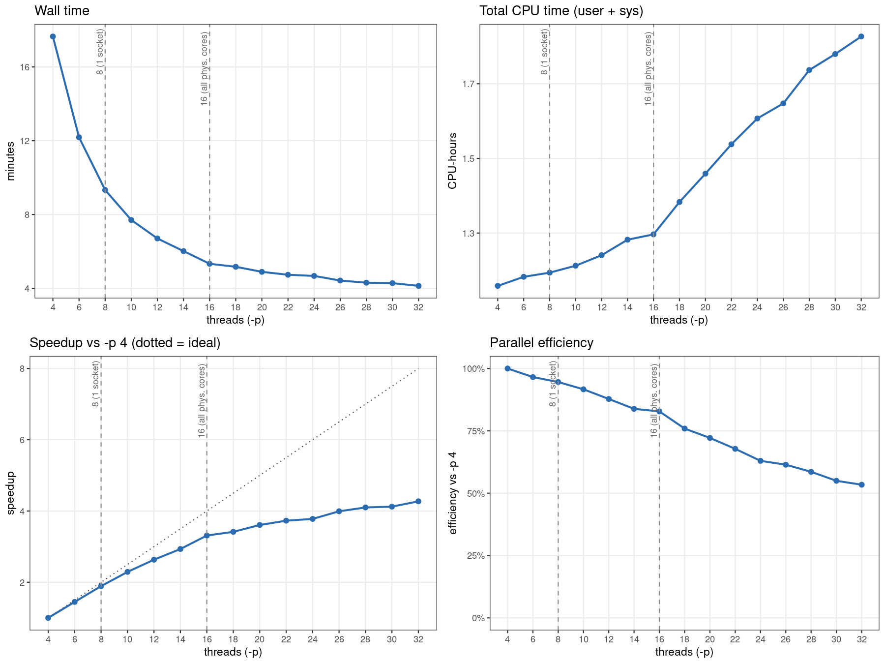

# svaba thread-scaling benchmark (chr17, tumor/normal WGS)

Generated by `opt/thread_scaling.sh`, plotted by `opt/thread_scaling_plot.R`.

- **Data:** osteosarcoma WGS, tumor `SG.wgs.UCLA.2025.01.tumor_cleaned.recal.bam` (363 GB)
  vs normal `blood.ss.cleaned.bam` (117 GB), region `chr17` (3,198 chunks).
- **Build:** svaba 2.0.0 @ `80431c2`, `build-jemalloc`, run through `svaba_jemalloc`
  with `MALLOC_CONF=background_thread:true,narenas:
,dirty_decay_ms:10000`.
- **Host:** GCE `n2-highcpu-32` (Intel Cascade Lake @ 2.80 GHz), 2 sockets × 8 cores × 2 HT = 32 vCPU,
  2 NUMA nodes, 66 MiB L3, 31 GiB RAM, pd-balanced disk (see `environment.txt`).
- **Method:** one `svaba run` per thread count (4, 6, … 32), page cache pre-warmed,
  timed with `/usr/bin/time` (wall, user+sys, max RSS). Single trial per point.

| threads | wall (min) | CPU-h | speedup vs 4 | efficiency | max RSS (GiB) |
|--:|--:|--:|--:|--:|--:|
| 4  | 17.7 | 1.16 | 1.00 | 100% | 7.8  |
| 8  | 9.3  | 1.19 | 1.89 | 95%  | 10.1 |
| 12 | 6.7  | 1.24 | 2.63 | 88%  | 12.2 |
| 16 | 5.3  | 1.30 | 3.31 | 83%  | 14.5 |
| 20 | 4.9  | 1.46 | 3.61 | 72%  | 16.5 |
| 24 | 4.7  | 1.61 | 3.78 | 63%  | 18.9 |
| 32 | 4.1  | 1.83 | 4.27 | 53%  | 21.6 |

Full table: `thread_scaling_summary.tsv`.

## Takeaways

- **Sweet spot = physical core count (`-p 16` here).** Up to 16 threads total CPU
  rises only ~12% over the whole range and efficiency stays above 80%.
- **Past 16 (hyperthreads) CPU cost climbs ~6× faster per added thread.** 16 → 32
  threads buys 22% less wall time for 41% more CPU-hours. Use only when wall clock
  is the sole concern.
- **No sharp knee at the socket boundary (8).** Efficiency declines smoothly
  through 4–16; NUMA cost is second-order at this scale.
- **Memory ≈ 5.5 GiB fixed (BWA index) + ~0.55 GiB/thread.**
- **Calls stable across thread counts:** 103,975–104,136 raw bps rows (±0.08%),
  i.e. small but non-zero run-to-run nondeterminism.

## Reference point: Manta 1.6.0, same region, `-j 16`

| | svaba `-p 16` | Manta `-j 16` |
|---|--:|--:|
| wall | 320 s | 139 s |
| CPU-h | 1.30 | 0.38 |
| peak RSS (summed over procs) | 14.5 GiB | 2.7 GiB |
| somatic SV PASS | 13 | 2 (both also in svaba's set) |
| indels | 18,315 PASS / 129 somatic | not called |
